# 04 — Flux d'exécution réel et différences entre parcours

## Flux de la tenue du jour (le parcours de référence)

```mermaid
flowchart TD
  A[regen — store.tsx:1209] --> B[composeWardrobePool<br/>réel d'abord, complétion par occasion,<br/>exclureHorsOccasion — selectors.ts]
  B --> C[recentsDuJour — 5 jours : portées, planifiées, recommandées]
  C --> D[genererTenueDiversifiee — diversite.ts]
  D --> E[tirer = generateOutfitWithFallback — logic.ts:1689]
  E --> F{pour chaque palier<br/>FORMALITY_FALLBACK_CHAIN}
  F --> G[attemptCoreOutfit — jusqu'à 20 generateOutfit<br/>tant que pas de socle — 1668]
  G --> H[generateOutfit — 721]
  H --> H1[saison déclarée dure du dressing — 791]
  H1 --> H2[hardCategoryFilter — 812<br/>sport/maison, R-B3, R-B6, R-B15, R-B20, R-B21, R-B22]
  H2 --> H3[occasion déclarée — 918 ; plage de température — 957]
  H3 --> H4[poolFor — échelle de replis — 1052]
  H4 --> H5[robe 40 % OU haut + bas — 1236 ; veste ; calques ; base sous calque]
  H5 --> H6[compensations : veste compensatrice, R-B18, collants R-B19]
  H6 --> H7[chaussures R-S16 ; sac ; gourde ; bijou et accessoire facultatifs]
  H7 --> I{socle valide ?}
  I -- non, palier suivant --> F
  I -- oui --> J[noCompleteOutfit = false, formalityDowngraded si palier < demandé]
  J --> K[16 tirages si historique : computeLookScore sur chacun — 2087]
  K --> L[choisirParDiversite : score − pénalité, éligibles ≤ 12 points]
  L --> M[état du store : outfit, drapeaux, planAppliqueId = null]
  M --> N[affichage : badge, bandeau de repli, suggestions R-S12/13/14]
```

### Étapes demandées, une à une

| # | Étape | Fonction | Peut supprimer / ajouter / réordonner | Ordre déterminant ? |
|---|---|---|---|---|
| 1 | Contexte (occasion, sous-contexte, météo, saisons) | `withDefaultOccasion`, `weatherForDay`, `saisonsDuJour` | — | oui : fixe `contexteSaison` |
| 2 | Filtrage initial | saison déclarée dure (791), `seasonPool` (800) | supprime les pièces réelles hors saison ; **jamais relâché** | oui |
| 3 | Compatibilité / exclusions | `hardCategoryFilter` (812) | supprime | oui |
| 4 | Composition progressive | `pick`, `harmonize`, `rand` | ajoute une pièce à la fois | oui : l'ordre haut → bas → veste → calque → chaussures → sac → gourde → bijou → accessoire décide de l'harmonisation (chaque pièce harmonise sur les précédentes) |
| 5 | Compensations | 1312, 1316–1341, 1471–1499 | ajoutent | après les couches probabilistes |
| 6 | Score | `computeLookScore` | ne modifie pas la tenue | calculé **après** compensations et ajouts |
| 7 | Anti-répétition et classement | `R-S15` (pénalité) ; `penaliteDiversite` ; `choisirParDiversite` | réordonne les candidats | oui |
| 8 | Seuils et badges | 2228 | — | — |
| 9 | Suggestions proactives | 2231–2364 | n'ajoutent rien à la tenue (carte « Ajouter à la tenue ») | après le score |
| 10 | Traitements avant affichage | `regen` : `planAppliqueId = null`, `plansEcartes` | un plan planifié est **écarté pour de bon** quand une nouvelle tenue est tirée | — |

Une règle précédente peut être **neutralisée** par : (a) l'échelle `poolFor` (météo, puis occasion relâchées — signalé par `occasionRelachee`), (b) les préférences molles qui ne s'appliquent que si elles laissent une option, (c) le repli de formalité (le plancher R-B3 descend de palier).

## Différences entre parcours

| Parcours | Différences avec la tenue du jour |
|---|---|
| Autre tenue / Autre idée | même `regen`, mais `choisirVariation` (12 essais) évite les tenues vues (`tenuesVues`, 30 dernières) et refusées ; tirage de secours avec un pool sans les pièces quittées |
| Planifier | météo du lieu et du moment (`meteoPourMoment`/`useMeteoDuPlan`), `soireeHabillee` déduite du contexte, humeur facultative (10 tirages, bonus ≤ 6) ; **pas** de pénalité de diversité sur 5 jours (`genererTenueHumeur` ≠ `genererTenueDiversifiee`) — non vérifié dans tous les appels |
| Comment porter cette pièce | `getOutfitsForItem` : `pinnedId` (la pièce reste tirable mais n'est jamais forcée), palette traitée comme incluant la teinte du pivot, colorimétrie « pivot accordé », `porterParDessus` pour une veste/un manteau, tirages **déterministes**, 60 tirages par occasion, 10 occasions, 3 idées par occasion, 18 au total |
| Idées du Dressing | tirages déterministes (`graineIdees`), complétion par la capsule seulement pour les pièces manquantes |
| Créer un look (manuel) | aucune génération : `applySportCocooningFilter` et `evaluateBlocking` (signalements), sans score imposé |
| Échange d'une pièce | `candidatsDeRemplacement` : mêmes règles **avec une divergence** sur la plage de température (anomalie A5) |
| Valise | `valise.ts` choisit des pièces du dressing, puis le moteur compose ; chaussures/sac complétés avec `{occasion, meteo}` (non relu en détail) |
| Adapter un look planifié | `alerteMeteo.ts` : candidats de remplacement ; une pièce qui déclenche une règle R-B1 à R-B10 n'est jamais proposée |

## Aléa

Le moteur n'est pas déterministe par défaut. Les écrans « idées » le rendent stable par `avecTirageDeterministe` ; la tenue du jour ne l'est pas (d'où la mémoire `tenuesParJourRef` et `recommandationsRecentes`).
